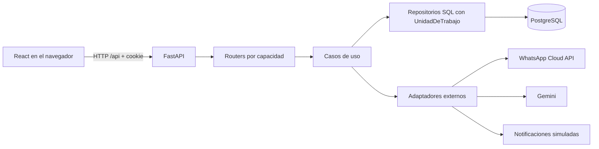

# Arquitectura del proyecto

Revisado el 17 de octubre de 2026 sobre `a62320c` más el reordenamiento sin
commit de esa fecha (código TSX inactivo retirado, errores y composición unificados).
Describe la implementación y distingue sus excepciones de las convenciones
para trabajo nuevo. Comandos en [DESARROLLO.md](DESARROLLO.md), criterios de
mantenimiento en [CLEAN_CODE.md](CLEAN_CODE.md).

El proyecto usa un **monolito modular con arquitectura screaming**: al abrir el
repositorio se ven primero las capacidades de Monu Burger y, dentro de cada
una, sus detalles tecnicos. Clean Architecture se mantiene **dentro** de cada
capacidad; no se reemplaza por carpetas globales `controllers/`, `services/` o
`repositories/`.

## Componentes y ejecución



- **Frontend:** React 19, Vite 8, React Router y Tailwind 4; npm con lockfile.
  El código de `src/` es JSX; el HTML carga `src/main.jsx`, que monta providers,
  `BrowserRouter` y `App.jsx`. TypeScript solo queda para `vite.config.ts`.
- **Backend:** Python 3.12+, FastAPI, Pydantic y psycopg 3. `run.py` inicia Uvicorn
  con la política de event loop necesaria en Windows. No hay ORM.
- **Persistencia:** PostgreSQL 16 en Compose y CI. La guía del proyecto menciona
  Supabase para la base compartida; su versión no se deduce de la imagen local.
- **Despliegue:** CI valida frontend y backend; no publica. El frontend contiene
  `public/_redirects` para fallback SPA y una Pages Function para reenviar `/api`
  a Render. Los modos de build separan clientes y personal manteniendo un único
  frontend. [Configuración y verificaciones](DESPLIEGUE.md). Estos archivos no
  demuestran que ambas variantes estén publicadas.
  Compose define PostgreSQL y backend, conserva un perfil opcional heredado de
  n8n y no incluye frontend. El bot se integra directamente y no usa ese perfil.

## Estructura canonica

```text
App/
├── backend/app/
│   ├── core/                         infraestructura transversal
│   └── modules/
│       ├── delivery/
│       ├── pedidos/
│       ├── productos/
│       ├── stock/
│       ├── pagos/
│       ├── reportes/
│       ├── usuarios/
│       └── notificaciones/
│           ├── domain/               reglas puras
│           ├── application/          casos de uso
│           ├── infrastructure/       SQL y servicios externos
│           └── presentation/         HTTP, esquemas y dependencias
└── frontend/src/
    ├── auth/                         sesión (AuthContext) y login
    ├── ordering/                     menú, layout del cliente y carrito
    ├── fulfillment/                  pedidos y delivery
    ├── kitchen/
    ├── inventory/
    ├── management/                   panel, catálogo y vistas administrativas
    └── shared/                       cliente HTTP y estado común (DataContext)
```

`App/frontend/` es el unico frontend valido. No se debe volver a crear
`frontend/` en la raiz del repositorio. El árbol es completo: todo `src/` es
alcanzable desde `main.jsx`. La integración TSX anterior (carrito, checkout y
seguimiento) y las vistas de registro/recuperación se retiraron el 17/10/2026;
recuperarlas desde el historial de Git si una tarea de producto las retoma.

| Capacidad backend | Responsabilidad y referencia |
| --- | --- |
| `usuarios` | Login, cookie, sesión, roles y administración de usuarios; `presentation/dependencias.py` expone guardas. |
| `productos` | Consulta del menú y gestión de productos con receta. |
| `pedidos` | Creación, variantes, dirección, consulta y transición de estado. |
| `stock` | Ingredientes, movimientos y consumo asociado al pedido. |
| `pagos` | Efectivo, transferencias, conciliación humana y caja; conserva el historial de medios anteriores. |
| `delivery` | Agrupación, asignación y ciclo de entrega de repartidores. |
| `reportes` | Consultas y agregaciones del negocio. |
| `notificaciones` | Plantillas, encolado y envío; el adaptador actual es simulado. |
| `whatsapp` | Borradores seguros, inbox/outbox persistentes, interpretación Gemini, cambios versionados y revisión humana. [Guía y límites](WHATSAPP_DESARROLLO.md). |

## Contrato de un modulo backend

1. Todo el codigo propio vive en `app/modules/<capacidad>/`.
2. `core/` no importa capacidades de negocio.
3. Las fabricas de servicios se declaran en
   `<capacidad>/presentation/dependencias.py`, no en
   `app/core/dependencias.py`.
4. Cada router se publica como una instancia `router` dentro de un archivo
   `presentation/router*.py`.
5. `app.main` descubre esos archivos automaticamente. Para agregar un modulo
   no se modifica `main.py`.
6. `domain/` no importa FastAPI, Pydantic, psycopg ni `app.core`;
   `application/` no importa FastAPI, Pydantic, psycopg ni `app.core.errores`.
7. Una capacidad no importa la infraestructura privada de otra. Si necesita
   colaborar, consume su aplicación o su fábrica pública de `presentation/dependencias.py`.
8. En cada endpoint protegido, la guarda de sesión o rol se declara antes del
   servicio: FastAPI resuelve en orden y así se rechaza sin pedir una conexión.

Las reglas 6 a 8 y las de `core`/`main` están cubiertas por `tests/test_arquitectura.py`.
Colaboraciones actuales: `pedidos` y `reportes` obtienen stock con
`obtener_servicio_stock(uow)`, compartiendo la unidad de trabajo del request; el
adaptador `pedidos/infrastructure/stock.py` implementa el puerto `ProcesadorStock`
sobre ese servicio. Todas las capacidades usan las guardas de `usuarios`.

Dentro de cada capacidad conviven dos estilos de aplicación: `pedidos`, `productos`,
`stock` y `reportes` reciben puertos `Protocol` (modelo para trabajo nuevo);
`delivery`, `pagos`, `usuarios` y `notificaciones` reciben la `UnidadDeTrabajo` y
su repositorio SQL concreto, y registran auditoría con `app.core.auditoria`.

`app/registro_modulos.py` busca `modules/*/presentation/router*.py`, importa cada
archivo y exige una instancia `APIRouter` llamada `router`. `app/main.py` compone
esa lista, CORS, handlers de error y el ciclo de vida del pool. `core/` contiene
configuración, base, auditoría y seguridad transversal.

Las excepciones compartidas están en `app/errores.py`, sin frameworks, y todo el
código las importa desde allí. `app/core/errores.py` solo contiene los manejadores
que traducen `ErrorDominio` (con su `codigo_http`) y la base caída (503) a JSON.
Los adaptadores traducen errores del driver; por ejemplo, el repositorio de usuarios
convierte `UniqueViolation` en `ReglaDeNegocio`.

Ejemplo minimo:

```text
app/modules/pagos/
├── domain/entidades.py
├── application/servicio_pagos.py
├── infrastructure/repositorio_sql.py
└── presentation/
    ├── dependencias.py
    ├── esquemas.py
    └── router.py                      exporta `router`
```

El descubrimiento tambien admite `router_caja.py`, `router_admin.py` u otros
routers de la misma capacidad, siempre que el nombre empiece con `router`.

## Contrato del frontend

- Las carpetas representan recorridos o capacidades, no tipos tecnicos.
- Un componente usado por una sola capacidad se queda dentro de ella.
- `shared/` no contiene reglas de pedidos, stock, caja o delivery.
- `App.jsx` compone navegacion y layouts; no guarda reglas de negocio.
- Las llamadas HTTP y el estado de una capacidad permanecen junto a esa
  capacidad.
- Las carpetas nuevas de capacidades se escriben en minúsculas con una sola
  convención; los componentes React mantienen PascalCase. No crear carpetas
  técnicas globales (`components/`, `hooks/`, `types/`) para código de una capacidad.

Las reglas anteriores orientan cambios nuevos. Hoy `shared/store/DataContext.jsx`
concentra estado y llamadas de varias capacidades. Evitar ampliarlo con lógica
ajena; una separación exige revisar todos sus consumidores. El cliente
`shared/api/http.js` usa `VITE_API_URL`, incluye cookies y normaliza errores.
Vite reenvía `/api` a `http://127.0.0.1:8000` en desarrollo.

## Flujos y límites de confianza

1. **Sesión:** `auth/AuthContext.jsx` usa la API de usuarios. El backend valida
   bcrypt/JWT y fija la cookie HttpOnly. El token identifica al usuario; cada petición
   autenticada consulta su estado, rol y permisos vigentes. Las dependencias de cada
   router autorizan por capacidad y el frontend adapta navegación y acciones con esa
   matriz. [Control de acceso](CONTROL_ACCESO.md) define versiones, auditoría y revocación.
   `/register` y `/recover-password` redirigen a login; no hay vistas ni endpoints
   de autorregistro o recuperación.
2. **Pedido:** presentación valida formato y rol; `ServicioPedidos` valida cliente,
   dirección, disponibilidad, cantidades y variante. Construye el snapshot de precio
   en servidor. `cliente.id` identifica al comprador comercial; `usuario_id` es un
   vínculo opcional con credenciales. Las cuentas anteriores resuelven ese vínculo
   para consultar sus pedidos. `ServicioPedidos` concentra las transiciones y
   correcciones; delivery lo consume por su fábrica pública con el mismo UoW.
   Pagos no modifica el estado físico. La preparación consume stock pendiente y
   exige el neto conciliado suficiente cuando el método acordado es transferencia.
   Las correcciones validan versión, situación de reparto y tratamiento de stock,
   preservando el número y el historial. [Reglas de operación](OPERACION_PEDIDOS.md).
3. **Stock y transacción:** `UnidadDeTrabajo` envuelve la conexión de psycopg.
   La dependencia del request comparte esa unidad con los repositorios; el contexto
   confirma al salir o revierte ante una excepción. Cambiar ese alcance puede dejar
   pedido, stock y auditoría inconsistentes.
4. **Pagos y caja:** efectivo y transferencia se registran bajo `modules/pagos`.
   Solo los movimientos conciliados integran el saldo acreditado y caja. Las
   operaciones se serializan por pedido y admiten reintentos identificados por
   UUID y contenido. Las rutas de Mercado Pago están retiradas; el adaptador
   histórico rechaza operaciones en lugar de simular pagos aprobados.
5. **Notificaciones:** el servicio compone plantillas y registra estado mediante
   repositorio. `EnviadorSimulado` registra el envío en logs; la sustitución por un
   proveedor real se conecta en `notificaciones/presentation/dependencias.py`.
6. **WhatsApp:** `/` abre el menú público y el carrito ofrece WhatsApp sin cuenta.
   El checkout crea un borrador anónimo separado, con referencia aleatoria
   almacenada como hash y vencimiento. El webhook firmado persiste el mensaje;
   el worker vincula la referencia vigente al remitente real bajo bloqueo y
   reutiliza su cliente por WhatsApp verificado, nunca por un teléfono declarado.
   `scripts/whatsapp_worker.py` interpreta y procesa fuera del request. La creación
   reutiliza `ServicioPedidos` y su UoW, vincula un único pedido y encola la respuesta
   atómicamente. Se separan conversación, pedido, revisión de transferencia y envío.
   Los cambios se aplican con bloqueo de pedido y versión; cocina recibe las
   aclaraciones vigentes. El personal revisa comprobantes y cambios en la bandeja
   de Pedidos; los repartidores no pueden aprobar ni descargar comprobantes.
   La migración 011 encola los cambios reales de estado mediante un trigger que
   también cubre los productores históricos de pagos/delivery. La cola de WhatsApp
   conserva aceptación, entrega, fallo e incertidumbre separados de la simulación.
   La 012 conserva callbacks adelantados y el repositorio los reconcilia bajo
   bloqueo por ID de proveedor. Gemini y Meta se llaman sin una transacción abierta.
   La 013 refuerza el bloqueo de preparación ante una transferencia cuyo neto
   conciliado ya no cubre el total, incluso si existió aprobación previa.
   Cada interpretación conserva el vínculo con la conversación y la huella del
   contexto que vio Gemini; al aplicar se revalida y nunca se redirige a otro
   pedido. La 014 registra derivaciones humanas en `whatsapp_atencion`, que el
   personal responde por la misma outbox y resuelve desde la bandeja.
   Este recorrido no usa el enviador simulado del módulo de notificaciones anterior.
   El adaptador web académico en `whatsapp/presentation/router_demo.py` reutiliza
   ese núcleo con una sesión anónima HttpOnly, identidad técnica propia y modo
   explícito. La publicación en base compartida requiere autorización persistida
   en `parametro.chat_demo_publico`, leída por `scripts.serve` al iniciar. Sin ella,
   se conserva la guarda local. La migración 027 persiste sesión,
   huellas idempotentes y archivos privados; el cliente declarado no se transforma
   en WhatsApp verificado. El worker enruta sus salidas por la sesión persistida
   y las deja `SIMULADO`, incluso si vence o cambia la configuración del transporte.
   Carrito y botón de chat viven en `ordering/ClientLayout.jsx`; el servidor es
   la fuente del historial y de los pedidos al recargar. Contratos, límites y
   comandos en [chat web de demostración](WHATSAPP_DESARROLLO.md#chat-web-de-demostración).

## Datos y configuración

Reportes y Analítica (`management/Analytics.jsx`) consulta `/api/reportes/dashboard`
y `/api/reportes/ventas?agrupacion=DIA` con fechas inclusivas; inicia en los últimos
30 días de Argentina. Requiere `reportes.ver`. Solo con `reportes.financieros`
consulta además `/api/reportes/rentabilidad` y muestra importes y cobros. La API de
rentabilidad exige ambos permisos; Administrador conserva los privilegios de la
política vigente. No hay endpoints nuevos ni cambios de esquema para esta pantalla.

El gráfico agrega **unidades**, con tabla diaria; muestra solo días con ventas.
El ranking es el del dashboard para todo el rango. `cantidad_pedidos` cuenta pedidos
distintos por producto y día; se suma por producto, nunca entre productos. La variante
financiera de ventas no devuelve ese conteo y la pantalla lo omite. Los conteos de
pedidos de hoy/semana/mes del dashboard no representan el filtro y no se muestran aquí.
Los importes vendidos suman subtotales de ítems a precios históricos, sin envío ni
propinas. Los cobros netos usan la fecha de conciliación: cobros menos devoluciones,
sin propinas, incluso si no hay ventas confirmadas en esas fechas. La rentabilidad
es estimada con costos actuales de insumos, no ganancia histórica exacta; costo cero
no distingue un costo genuino de uno sin cargar. No se estima un total de pedidos
únicos ni se reemplazan valores ausentes por importes ficticios.

Al editar fechas se retiran los resultados hasta aplicar un rango válido. Cada lote
de reportes se publica completo o muestra error con reintento. No se conservan
resultados visibles tras fallar o iniciar otra consulta. El efecto cancela y descarta
respuestas anteriores; también vincula los datos al objeto de sesión vigente para
evitar reutilizarlos entre usuarios del mismo rol o tras cambios de permisos.

El directorio de Clientes consulta `GET /api/reportes/clientes`, con búsqueda y
paginación. Solo empleados, administradores y dueños pueden acceder. Agrupa por
`cliente.id`, incluye compradores sin cuenta y cuenta sus pedidos sin multiplicarlos
por ítems o pagos. La fecha mostrada es la del primer pedido. El enlace a Pedidos
usa `cliente_id` exacto; el servidor conserva las restricciones de clientes y repartidores.

El frontend comparte solicitudes pendientes y conserva datos al actualizar. Catálogo
e inventario se consultan al abrir su pantalla, con caché de navegación de 30 segundos.
Clientes mantiene una caché acotada a la sesión y se actualiza cada 15 segundos cuando
está visible; Pedidos y Cocina sondean pedidos activos cada 8 segundos mientras se usan.
Las lecturas anteriores o iniciadas durante una escritura no pueden sobrescribirla;
al terminar se consulta el estado canónico. El detalle usa el DTO conocido al abrir
y comprueba la versión vigente en segundo plano. Los cambios siguen validados por la API.

`App/db/migrations/` contiene SQL numerado; `scripts.migrate` registra checksum en
`schema_migrations`. El seed se carga explícitamente. No editar migraciones ya
aplicadas. `scripts.der` y `scripts.diccionario` generan la referencia del esquema.

`core/config.py` lee variables de entorno y `.env` local o de `App/`. Las variables
de entorno tienen prioridad; `.env` no se versiona. Las opciones `VITE_*` son
públicas en el bundle: solo configuración apta para navegador.

## Extender sin duplicar

Para una nueva capacidad backend, crear dominio, aplicación, adaptadores y
presentación en su carpeta, publicar `router` y construir las dependencias ahí.
Agregar pruebas de comportamiento y contrato; `main.py` no necesita registro manual.
Usar `pedidos/application/servicio_pedidos.py` como ejemplo de puertos y
`pedidos/presentation/dependencias.py` como ejemplo de composición entre capacidades.

Para una función de frontend, seguir la capacidad dueña, sus rutas, providers y
cliente HTTP. Si hace falta cambiar un contrato, coordinar esquemas backend y
consumidores dentro de la misma tarea. No habilitar nuevas pantallas por
la mera existencia de componentes sin una necesidad de producto.

## Verificación y mantenimiento

`tests/test_arquitectura.py` comprueba descubrimiento de routers, rutas únicas,
ausencia de imports de capacidades en `core`/`main`, pureza de dominio y aplicación,
que ninguna capacidad importe infraestructura ajena, el orden guarda → conexión y
el frontend único. No comprueba qué contratos de aplicación usa cada capacidad.
Los comandos completos y el comportamiento del CI están en
[DESARROLLO.md](DESARROLLO.md).

La integración de `integracion/prueba` en `main` se realizó por avance directo a
`a62320c`; las instrucciones antiguas por rama se conservan en el historial y en
[INTEGRACION_PRUEBA.md](INTEGRACION_PRUEBA.md). No volver a ejecutar esa integración
como parte de una tarea ordinaria. Limitaciones actuales en
[DEUDA_TECNICA.md](DEUDA_TECNICA.md).
